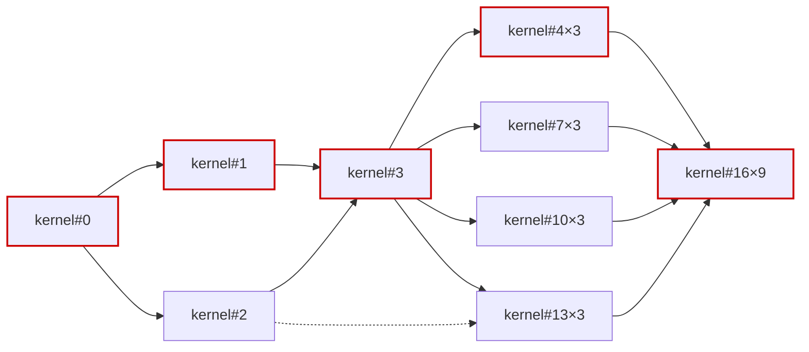

# graph-lint

[](https://github.com/MardokHPC/graph-lint/actions/workflows/ci.yml)

A linter for the topology of a `cudaGraph_t`.

## Status

`graphlint_report` and `graphlint_gate` work end to end: a graph document in, a report out, and a
verdict with exit code 0, 1 or 2. The library behind them is header-only, and the whole core builds
without CUDA or a GPU.

- `from_cuda` reads a `cudaGraph_t` into `graphlint::Graph`, and `write_graph_json` takes that same
  handle to a file in one call; `dump_graph` and `parse_graph` write and read the model as JSON, byte
  for byte.
- `topology` and `critical_path` give depth, width per level, the transitive reduction and the
  heaviest path; `lint` turns them into findings, each rule with the reason it applied or did not.
- `to_dot` and `to_mermaid` draw the same graph deterministically; Mermaid compresses chains and
  marks the critical path.
- `apply_weights` applies a measured table in nanoseconds, and the report compares `path_ns`.
- `build-host.bat` runs everything that needs no card; `build-device.bat` adds the device tests, the
  demo, the example and the benchmark.

## What it is

`graph-lint` reports the topology of a `cudaGraph_t`: depth in levels, width per level, the edges a
transitive reduction removes and the minimal DAG that remains, the synchronization nodes (host
callbacks, event record and wait, external semaphore), and the peak device bytes held by the
`cudaMallocAsync` nodes. One document per graph, fixed key order, no timestamp and no local path, so
a report is a diffable artifact.

The model in `graph.hpp`, the reader in `cuda_source.hpp`, the analysis in `analysis.hpp` and the
rules in `rules.hpp` are what a report is built from, and `report.json` is their first consumer:
`graphlint_report` writes it, `graphlint_gate` compares two of them and recomputes the analysis from
the embedded graph, so a stale block cannot decide a verdict (`docs/report.md`). What each rule
measures, and the case where it must stay silent, is `docs/rules.md`; what the numbers mean — levels,
width, the reduction, the path — is `docs/topology.md`.

The drawing below is `to_mermaid` of `graphs/captured.json`: four chains of three kernels are one
box each (`kernel#4×3`, `kernel#7×3`, `kernel#10×3`, `kernel#13×3`), the one dashed edge is a pair
the transitive reduction removes, and the red class is the longest path, five of the nine boxes. A
host test compares this block with the emitter byte for byte, so the figure cannot drift on its own.



## Three steps

`examples/three_lines.cu` captures four launches on two streams, reads the capture back through the
same reader and prints the topology; most of the file is error handling. On this machine:

```text
graph-lint example | NVIDIA GeForce RTX 2060 SUPER | CUDA runtime 12.6
captured: 4 nodes, 4 edges
topology: depth 3 levels, width_max 2
reduction: 0 of 4 edges redundant, minimal DAG 4 edges
findings: 1
  info   pointless-fork [0, 3]: node 0 splits into 2 single-node branches that rejoin at node 3: the fork buys nothing
wrote %TEMP%/graphlint_three_lines.json (474 bytes)
report: graphlint_report "%TEMP%/graphlint_three_lines.json" --format summary
```

The capture shows the rule the tool exists for: four launches become a diamond and two `cudaEventRecord`/`cudaStreamWaitEvent` pairs become edges, not nodes, so the fork is one node deep on each side. The last line is the check: the JSON it wrote is read back by the report binary with no CUDA. `build-device.bat example` builds and runs it.

## Your own graph

You already have a `cudaGraph_t`: one include, one call, and no library to link.

```cpp
#include <graphlint/cuda_source.hpp>

// handle is the cudaGraph_t you already hold.
std::string error;
if (!graphlint::write_graph_json(handle, "mine.json", error)) {
    std::fprintf(stderr, "%s\n", error.c_str());
}
```

The reader is a header in `include/graphlint`: point the compiler at that directory and cudart is the
only library behind it, which a program holding a handle already links. In CMake,
`find_package(graphlint CONFIG)` or `add_subdirectory` hands out `graphlint::cuda` with the include
path and cudart already attached. No graph yet? `graphlint_report --template mine.json` writes a
two-node starting document, and refuses with exit 2 if the file already exists.

    graphlint_report mine.json --format summary

The document schema is in [`docs/graph.md`](docs/graph.md).

## What it is not

| incumbent | what it gives |
|---|---|
| `cudaGraphDebugDotPrint` | the toolkit's DOT writer: a drawing, no report, and output that is not stable across toolkit versions |
| Nsight Systems, Nsight Compute | a timeline and per-kernel counters with durations, not a verdict on the topology |
| `cudaGraphGetNodes`, `cudaGraphGetEdges` | handle and edge arrays: any number built on them is twenty lines of your own code |

`cudaGraphDebugDotPrint` sits first because it is the closest thing the toolkit ships. `to_dot`
differs on the three points that make a drawing diffable: ids shared with the JSON, order by id, and
identical bytes across runs on the same driver (`docs/emitters.md`). It is a drawing, not a verdict:
the findings come from `lint`, and no emitter reads them.

It is not a rewriter: the reduction is reported, never applied (`docs/limits.md`).

## When to use it

For the engineer holding a captured or hand-built `cudaGraph_t` who needs its depth and width
before deciding where to split a stream. For the team comparing two graph versions that wants the
difference as a file in a review. For the reviewer who has to explain what changed in a graph
without reading a list of node handles.

    graphlint_report graphs/pingpong.json --format json --out current.json
    graphlint_gate --baseline baseline.json --current current.json

Exit 0 means the topology did not get worse, 1 means it did, 2 means the two reports cannot be
compared - another schema, another source kind, nanoseconds before the weights exist.

## Limits

A level is a dependency, not a time. The reader sees the template, not the instantiated graph:
kernel names and parameters, mutations applied to a `cudaGraphExec_t`, and durations never reach a
report. `docs/limits.md` lists every missing field and why it is a property of the CUDA API, not a
defect waiting for a fix.

## Quality

The host suite needs no CUDA toolkit and no GPU: 225 GoogleTest cases in twelve binaries (`config` 3,
`graph` 11, `json` 28, `analysis` 30, `rules` 51, `emitters` 24, `report` 22, `gate` 27, `weights` 21,
`demo_check` 5, `bench` 2, `weights_artifact` 1). ctest runs 42 entries: those twelve, `artifacts_locale`,
`report_ns_determinism`, and twenty-eight process-level entries that run the two tools and assert
exit codes, stderr and byte equality. `ctest --test-dir build-host -V` prints the per-binary counts.
`artifacts_locale` is not a GoogleTest binary: it reruns `emit_artifacts` in a second process under
`LC_ALL=de_DE.UTF-8` and `TZ=Asia/Tokyo`, then compares the eight files with `graphs/` byte for byte.

The device suite is 9 cases in one ctest entry. They passed on the card named below; with no visible
card the binary exits 77 and ctest reports the entry SKIPPED:
`set CUDA_VISIBLE_DEVICES=-1 && ctest --test-dir build-dev --output-on-failure`.

`graphs/` holds four documents read from real handles by `tests/device/demo_graph.cu`:

- `built.json` — 27 nodes, 30 edges, depth 17, 0 redundant edges, 2493 bytes
- `captured.json` — 25 nodes, 29 edges, depth 15, 1 redundant edge, 2334 bytes
- `pingpong.json` — 12 nodes, 21 edges, depth 12, 10 redundant edges, 1261 bytes
- `chain.json` — 1000 nodes, 999 edges, depth 1000, 0 redundant edges, 89792 bytes

`demo_check`, a host ctest entry, re-asserts nodes and edges from the committed files and checks
that parsing then dumping each one returns the same bytes; `wc -c graphs/*.json` gives the byte
counts. Depth and the redundant count are asserted by `graphlint_test_analysis`, which reads the
same four files with no GPU, and for the three small shapes the same numbers are recomputed by a
separate naive reference inside the test: if the files and the reference disagree, the failure names
the node or the edge.

`build-device.bat demo` regenerates the four files. Two consecutive runs produced the same SHA256
for all four (`sha256sum graphs/*.json` before and after the second run). They were generated on one
machine: RTX 2060 SUPER (sm_75), driver 610.88 reporting CUDA API 13.3, runtime 12.6. Environment
and full evidence: `graphs/REPORT.md`. The numbers were checked against a separate implementation
when they were first measured; `experiments/` keeps that check.

`build-device.bat bench` answers the other question, what a graph pays for its dependencies: it
builds `tools/bench.cu` against `cuda-timer` v1.2.2 and rewrites `docs/bench/bench.json`. The table
with its min-max intervals, the protocol, and the three reasons a number from it cannot be quoted
alone are in [`docs/bench.md`](docs/bench.md).

The same command also measures one node at a time and writes `docs/bench/weights.json`, closing the
loop from topology to nanoseconds: the report turns a level count into a path in time, and the
lower bound it is and is not is stated in [`docs/bench.md`](docs/bench.md#from-topology-to-time).

CI runs two jobs:

| job | environment | what it does |
|---|---|---|
| `host-only` | ubuntu-22.04, windows-2022, no toolkit | builds the core and runs the host suite |
| `cuda` | ubuntu-22.04 with CUDA 11.8 and 12.1, windows-2022 with 12.9 | compiles the reader, the demo, the example and the device suite on sm_75, then builds `tests/consumer_cuda` against the installed package |

The `cuda` job has no GPU: it proves the CUDA path compiles, not that it reads a handle. The
host-only job also installs the package into a scratch prefix and builds `tests/consumer` against
`find_package(graphlint CONFIG)`. The 9 device cases are the only ones that have touched a card.
The matrix is in `.github/workflows/ci.yml`.

## Build

CMake 3.20 or newer, Ninja, a C++17 compiler. The host build fetches GoogleTest v1.15.2 at configure
time and needs no CUDA toolkit, no nvcc and no GPU:

    build-host.bat configure
    build-host.bat build
    build-host.bat test
    build-host.bat artifacts

`build-host.bat artifacts` rewrites `graphs/*.dot` and `graphs/*.mmd` from the four JSON, and both
the suite and the README figure are then compared with those files byte for byte. The same build
produces `graphlint_report` and `graphlint_gate`; the gate is the only binary that can exit 1.

The reader is a header: `GRAPHLINT_WITH_CUDA=ON` adds the toolkit's include path and `cudart` to
`graphlint::cuda`, and nothing is compiled into a library. It needs a toolkit of 11.4 or newer, where
the mem-node and child-graph getters arrive. nvcc enters only with `GRAPHLINT_BUILD_DEVICE_TESTS=ON`,
which adds the demo and the device suite:

    build-device.bat configure
    build-device.bat build
    build-device.bat demo
    build-device.bat test

`build-device.bat example` additionally builds `examples/three_lines.cu` under
`GRAPHLINT_BUILD_EXAMPLES=ON` and runs it; the capture path needs a card, so the binary exits 77 and
ctest reports it SKIPPED elsewhere.

On Windows the two scripts wire two toolchains that normally fight over PATH: Visual Studio 2022
BuildTools for the host compiler, CUDA 12.6 for nvcc. `build-device.bat` sets
`NVCC_PREPEND_FLAGS=--allow-unsupported-compiler`, because CUDA 12.6 does not know MSVC 14.44.

## Repository structure

Tracked files only; `build*/` trees are ignored.

```text
graph-lint/
├── include/graphlint/
│   ├── analysis.hpp
│   ├── config.hpp
│   ├── cuda_source.hpp
│   ├── emit_dot.hpp
│   ├── emit_mermaid.hpp
│   ├── gate.hpp
│   ├── graph.hpp
│   ├── json.hpp
│   ├── report.hpp
│   ├── rules.hpp
│   └── weights.hpp
├── examples/
│   └── three_lines.cu
├── tests/
│   ├── consumer/
│   │   ├── CMakeLists.txt
│   │   └── main.cpp
│   ├── consumer_cuda/
│   │   ├── CMakeLists.txt
│   │   ├── main.cpp
│   │   └── other.cpp
│   ├── data/graphs/
│   │   ├── chain8.json
│   │   ├── child_graph.json
│   │   ├── diamond.json
│   │   ├── empty.json
│   │   ├── mixed.json
│   │   ├── ns.json
│   │   └── template.json
│   ├── data/reports/
│   │   ├── baseline.json
│   │   ├── depth_plus_one.json
│   │   ├── host_node.json
│   │   ├── ns_baseline.json
│   │   ├── ns_path_plus_one.json
│   │   ├── ns_weights.json
│   │   ├── other_source.json
│   │   └── truncated.json
│   ├── data/weights/
│   │   ├── diamond.json
│   │   └── unit_us.json
│   ├── device/
│   │   ├── demo_check.cpp
│   │   ├── demo_graph.cu
│   │   └── test_cuda_source.cu
│   ├── tools/
│   │   ├── check_host_package.cmake
│   │   ├── report_determinism.cmake
│   │   ├── report_out.cmake
│   │   ├── report_template.cmake
│   │   └── run_expect.cmake
│   ├── check_artifacts.cmake
│   ├── test_analysis.cpp
│   ├── test_bench_report.cpp
│   ├── test_config.cpp
│   ├── test_emitters.cpp
│   ├── test_gate.cpp
│   ├── test_graph.cpp
│   ├── test_json.cpp
│   ├── test_main.cpp
│   ├── test_main_device.cpp
│   ├── test_report.cpp
│   ├── test_rules.cpp
│   ├── test_weights.cpp
│   └── test_weights_artifact.cpp
├── tools/
│   ├── bench.cu
│   ├── emit_artifacts.cpp
│   ├── gate.cpp
│   ├── report.cpp
│   ├── report_core.hpp
│   └── weights.cu
├── graphs/
│   ├── built.dot
│   ├── built.json
│   ├── built.mmd
│   ├── captured.dot
│   ├── captured.json
│   ├── captured.mmd
│   ├── chain.dot
│   ├── chain.json
│   ├── chain.mmd
│   ├── pingpong.dot
│   ├── pingpong.json
│   ├── pingpong.mmd
│   └── REPORT.md
├── docs/
│   ├── bench/
│   │   ├── bench.json
│   │   ├── measured.json
│   │   └── weights.json
│   ├── bench.md
│   ├── CONVENTIONS.md
│   ├── emitters.md
│   ├── graph.md
│   ├── limits.md
│   ├── report.md
│   ├── rules.md
│   ├── topology.md
│   └── weights.md
├── experiments/
│   ├── m0_graph/
│   │   ├── REPORT.md
│   │   ├── REVIEW.md
│   │   ├── run.bat
│   │   └── shape.cu
│   └── m2_api/API_NOTES.md
├── cmake/graphlint-config.cmake.in
├── .github/workflows/ci.yml
├── .github/workflows/release.yml
├── .gitattributes
├── .gitignore
├── CMakeLists.txt
├── build-device.bat
├── build-host.bat
├── CHANGELOG.md
├── LICENSE
└── README.md
```

## License

MIT, Copyright (c) 2026 MardokHPC. The full text is in `LICENSE`.
