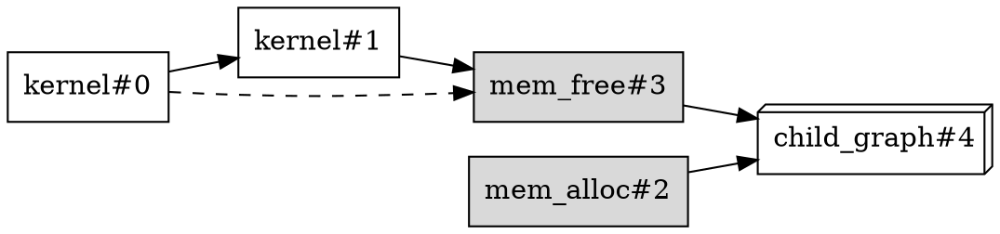
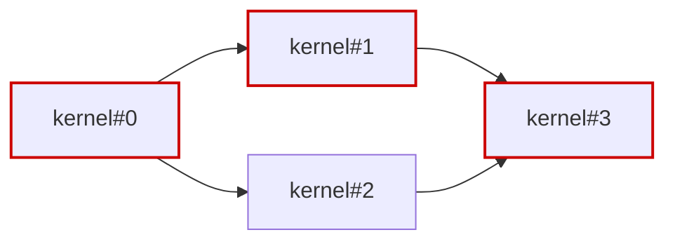

# Emitters — the contract M5 must satisfy

## 1. API

```cpp
struct DotOptions { bool detail_params = false; };   // --dot-detail=params
struct MermaidOptions { int max_nodes = 80; };       // --max-nodes
[[nodiscard]] inline std::string to_dot(const Graph& g, const Topology& t, const DotOptions& o = {});
[[nodiscard]] inline std::string to_mermaid(const Graph& g, const Topology& t,
                                            const MermaidOptions& o = {});
```

- `[[nodiscard]] inline`, in `emit_dot.hpp` and `emit_mermaid.hpp`. Both return the whole document, LF-terminated; they cannot fail and never throw. The precondition is what `topology` leaves: `t.acyclic`, `t.level.size() == g.nodes.size()`, and `t.edges_minimal` plus `t.edges_redundant` equal to the distinct pairs of `g.edges`. A mismatched `(g, t)` pair trips a debug `GRAPHLINT_ASSERT`; a refused graph is `dag-check`'s `error` finding, with nothing to draw.
- Root graph only: a `child_graph` is one box and `g.children` is not drawn, the scope `lint` already has.

## 2. DOT

`digraph graphlint {`, `rankdir=LR;`, `node [shape=box];` are the only defaults. Then one line per node in id order, a blank line when both blocks are non-empty, one line per distinct edge sorted by `(from, to)`, `}`. Two-space indent, `;` ends every node and edge line, attributes keep the order `label`, `shape`, `style`, `fillcolor`. A duplicate pair is `dag-check`'s business: the drawing shows the relation, once.

`tests/data/graphs/mixed.json` — two kernels, an alloc/free pair, a child, one redundant edge — dumps exactly:



A label is the kernel `name` when the node has one (`n0 [label="a"]` in `diamond.json`), else `<type>#<id>` with the `to_string(NodeType)` token, so the rendered picture carries the id of the JSON artifacts and of a finding's `nodes`. Orange marks the node class `sync-node` measures, never a severity: findings are not an input of an emitter.

| type | DOT | Mermaid |
|---|---|---|
| `kernel`, `empty`, `unknown` | default box | `["…"]` |
| `memcpy`, `memset` | `shape=parallelogram` | `/["…"/]` |
| `mem_alloc`, `mem_free` | `style=filled, fillcolor=gray85` | `[("…")]` |
| `event_record`, `event_wait`, `host`, `ext_semaphore` | `shape=octagon, style=filled, fillcolor=orange` | `{{"…"}}` plus `sync` |
| `child_graph` | `shape=box3d` | `[["…"]]` |

`detail_params` appends to the label after a DOT `\n` (backslash, `n`): `grid 14x14x1 block 128x1x1` for a kernel and `shared 8192 B` when `shared_bytes != 0`; `1048576 B` and `ptr 0x7f0000000000` for an alloc, `ptr 0x…` for a free, `child 0` for a child graph. Bytes decimal, hex lowercase and unpadded.

`name` is untrusted — a file writes it, a driver supplies it — so a label is built in three steps: a byte-level UTF-8 check, and a name that fails it becomes the fallback `kernel#<id>`; every byte below 0x20 or equal to 0x7F, a newline and a tab included, becomes one space; `"` becomes `\"` and `\` becomes `\\`, the only two characters special inside a quoted DOT id, which is why `{`, `}`, `|` and `<` need nothing. Nothing is truncated: a cut name makes two different kernels look equal.

An edge in `t.edges_redundant` is `[style=dashed]` here too, not only in Mermaid: the reduction is the claim of the tool, and the DOT is the view that survives a renderer refusing Mermaid. The critical path is not marked, because dot chooses the ranks, and red on a layout we did not compute is a claim we cannot back.

## 3. Mermaid

`flowchart LR`; node lines in ascending drawn id; edge lines `n<a> --> n<b>`, dotted as `-.->` for a pair in `t.edges_redundant`, sorted by `(from, to)`; the two `classDef` lines always; `class … critical` and `class … sync` only when their set is not empty. Two-space indent, no `;`, no blank line. Ids are `n<id>`; node labels are always `<type>#<id>` or `<type>#<head>×<count>` and never the `name`, so the alphabet closes on the type token, `#`, digits and `×` and no label can break the diagram — a bare `#` is a Mermaid entity only before a `;`, which this alphabet cannot produce; the cap banner is the one label outside it and carries no `"` or `;`.

A kernel is interior when it has exactly one predecessor and one successor, degrees counted over distinct pairs. Chains are built in id order and a node joins its predecessor's chain when both are `kernel`, that is the predecessor's only out-edge and the node's only in-edge; otherwise it starts a chain. So every kernel belongs to exactly one chain, a fan-out or a fan-in ends it, and a chain covers consecutive levels. Two or more nodes draw as `n<head>["kernel#<head>×<count>"]`, head being the smallest id, because ids are a topological order. A test that only fan-outs at the head is not enough: in `diamond.json` nodes 1 and 2 are interior yet start their own chains, since node 0 has two successors.

Fan-in and fan-out survive: every member but the head takes its only in-edge from the member before it and every member but the tail sends its only out-edge to the member after, so the drawn node's external in-edges are the head's and its external out-edges the tail's; a chain also covers consecutive levels, so `depth` does not move. Only kernels join a chain — a sync node is context, and a mem node carries the alloc/free pair whose overlap is the finding, so a `k×4` swallowing `mem_alloc` and `mem_free` would delete the subject of `mem-lifecycle`. An edge with both endpoints in one drawn node is dropped: the chain is the implication.

The critical path is the longest path in hops, found on the model before compression: start at the smallest id with `level == depth - 1` and step back to the smallest id among its predecessors one level down. Every node above level 0 has one, so the walk reaches level 0 and no tie depends on iteration order. Each id maps to the node holding it; a chain is wholly on the path or wholly off it, because the path can enter it only at the head and leave only at the tail. Weights in ns (M7) turn the walk into the heaviest path; the tie-break stays.

`max_nodes` counts drawn nodes, after compression; a value below 1 is the caller's error and the emitter does not clamp. Over the cap the diagram is still emitted whole, and the first node line is an unconnected banner: `limit["131 nodes after compression, over --max-nodes 80: see the DOT output"]`. Never truncated, because a cap that drops a branch in silence is worse than a long diagram, and never a `%%` comment, which GitHub hides: a node is the only banner the reader sees.

`tests/data/graphs/diamond.json` — nothing compresses, the names are dropped, and `0→1→3` ties `0→2→3`:



## 4. Determinism

- Both are pure in `(g, t, options)`: no clock, locale, path, pointer value, environment or static state. Two calls, and two processes, produce the same bytes.
- Every sequence is total: nodes by id, edges by `(from, to)` after deduplication, chains by head id, `class` lists ascending. No `unordered_*` container is iterated; where a set is needed it is a sorted `vector`, and no id is generated — `n<id>` comes from the model.
- Integers go through `std::to_chars` as in `json.hpp`, never `std::to_string` or a stream, and UTF-8 validity is a byte check, never `mbrtowc`/`isprint`: `LC_ALL` moves no byte. Line endings are LF only, one at the end of the last line, no BOM, no trailing blank line; writers open the file in binary mode, so Windows text mode never turns LF into CRLF on an artifact that is committed and diffed.

## 5. What they are not

- No layout: no coordinates, no `pos`, no `rank=same`; Graphviz and Mermaid place the nodes.
- No colour for severity: findings never reach an emitter.
- No `name` in Mermaid: the label is the type token and the id, nothing else.
- No port or data on an edge: the model holds a pair, the drawing prints a pair.

## 6. Tests

- `to_dot` of `mixed.json` byte-pinned to §2; `to_mermaid` of `diamond.json` to §3. The expected bytes live in the test, and `graphs/{built,captured,pingpong,chain}.{dot,mmd}` are regenerate-and-compare artifacts like the four JSON: the README figure cannot age alone.
- Both functions on all four `graphs/*.json`: two calls in one process, then a second process with `LC_ALL=de_DE.UTF-8` and `TZ=Asia/Tokyo`, same bytes.
- A 14-kernel chain between two fan-ins and three fan-outs draws one `kernel#<head>×14` with the in- and out-edge counts of the model unchanged, and a chain interrupted by `event_wait`, `mem_alloc` or `mem_free` draws separate nodes; `chain8.json` gives `n0["kernel#0×8"]`.
- A name carrying `"`, `\`, `\n`, a tab, 0x01 and 0x7F yields one line per node with the escaped bytes; a name carrying a lone 0xC3 falls back to `kernel#<id>`.
- Empty graph and a single node without edges: the DOT closes after `node [shape=box];` or after one node line, the Mermaid is the header and the two `classDef` lines. Over `max_nodes`, the banner carries the exact drawn count and every drawn node is still present; `chain.json` (1000 nodes, one box) stays under the cap.
- Two paths of length `depth`: the `class` list is the one the back-walk picks, so `0→2→3` in `diamond.json` is not red.

